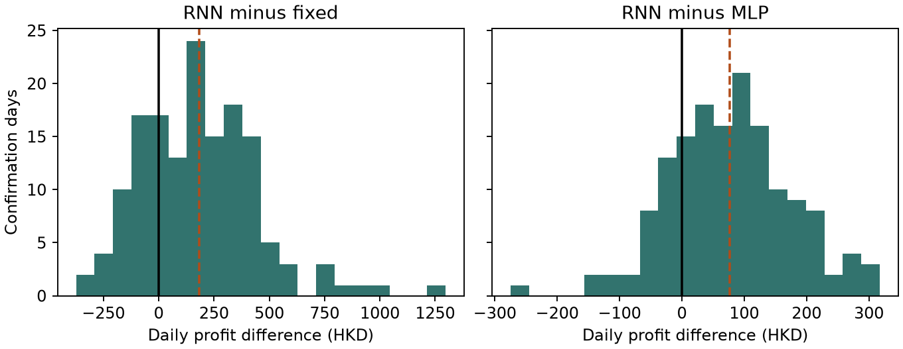
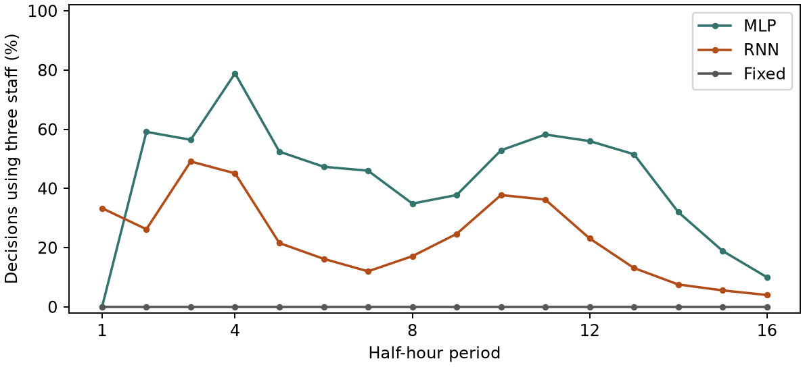
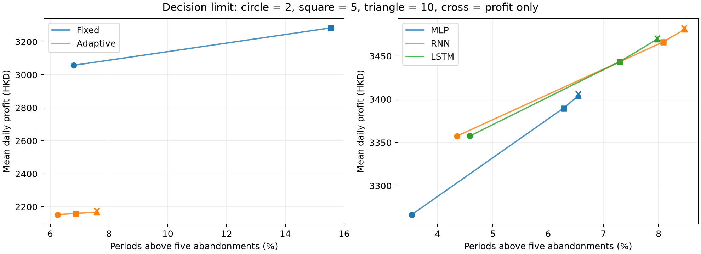

# Managing a café under uncertain demand

## Executive summary

A café chooses prices, staffing and prepared stock every half hour while customers decide where to buy and how long to wait. We studied whether a manager using recent observations could earn more than the best constant action while keeping mean abandonment at or below five customers per period.

On 150 fresh simulation days, a vanilla recurrent neural network (RNN) earned **HKD 3,466 per day**, compared with **HKD 3,390** for a multilayer perceptron (MLP) and **HKD 3,284** for the fixed manager. The RNN’s paired gain over fixed was **HKD 182 per day**, or **5.5%** (95% interval HKD 141–224). The MLP provided the most consistent service of the three. It exceeded five abandonments in **6.28%** of periods, compared with **8.08%** for the RNN and **15.54%** for fixed.

The difference between the neural managers is visible in their accounts. On the same days, the RNN spent about HKD 127 less on staffing and HKD 140 less on preparation per day than the MLP. It also took in about HKD 190 less revenue. The savings exceeded the lost revenue, giving it a net advantage of HKD 77 per day.

## 1. Market and decision

Two cafés compete for customers buying espresso, latte or pastry over an eight-hour day. Café B keeps base prices, two staff and ten prepared units per product. Café A chooses among 27 combinations every 30 minutes: a whole-menu price multiplier of 0.9, 1.0 or 1.1, one to three staff, and six, ten or sixteen units of each product. Preparation and staffing costs apply even when nothing sells. Unused stock expires at the period boundary, while the queue carries over.

Daily profit is sales revenue less the cost of all prepared stock and staffed periods. One member of staff costs HKD 40 per period. An abandonment counts a customer who joined A’s queue and left before purchasing. A customer choosing B or declining to enter does not count toward A’s abandonment. We report both **mean abandonment per period**, used for manager selection, and **the share of periods exceeding five**, which exposes service failures hidden by a daily average.

Customers use a tabular policy learned from simulated arrival and waiting decisions. We selected the 4,000-day customer checkpoint after comparing it with an 8,000-day checkpoint on 270 matched days. Mean customer return was 5.295 versus 5.247. We froze those tables throughout the management experiments so all managers faced the same learned customer preferences.

## 2. Data, managers and evaluation

We generated 1,000 independent demand schedules. Each was run twice, once with a uniformly sampled action every period and once with actions held for two to four periods. Each observed action contributed its own realized outcome. Splitting by day kept both trajectories together: **700 training days (22,400 periods), 150 validation days (4,800 periods), and 150 test days (4,800 periods)**. Histories stay within a trajectory. Scaling uses training periods only.

| Manager | Decision and selection |
|---|---|
| Fixed | Try all 27 constant actions on validation days. Action 4 won: 90% of base prices, two staff, ten units per product. |
| Adaptive | Smooth previous entries, choose staffing and stock from expected demand, and raise prices under queue pressure. Of eight settings, validation selected smoothing 0.6, stock buffer 1.0 and queue threshold six. |
| Neural | Use four pre-decision observations of 30 features each, plus the candidate’s seven numeric price, staff and stock fields. Predict three sales counts, abandonment and mean served wait for every candidate. |

The neural manager selects the action with the highest predicted profit among candidates with predicted abandonment at most five. If none qualifies, it minimizes predicted abandonment, then maximizes profit. Stable action IDs resolve final ties. Predicted sales are bounded by prepared stock. Waiting-time loss uses periods with at least one purchase.

**Forecast evaluation** measures error on recorded exploratory actions. **Business evaluation** gives each manager control of A for a full day, allowing its actions to change queues, customer choices and later observations. All managers see matched arrival schedules. Checkpoint selection uses validation forecast loss; manager selection uses realized validation profit under the service constraint. Each neural seed controls the café independently. We average seeds within each day before comparing managers, so 150 days remain 150 independent units.

## 3. Original held-out comparison

The original specification supplied the architectures and optimizer settings. The MLP used hidden widths 64 and 32. The LSTM used 32 recurrent units and a 32-unit head, resetting recurrent state for each window. Both used Adam at 0.001, batch size 128, and early stopping after ten epochs without improvement. We evaluated three training seeds per architecture.

| Manager | Mean daily profit (HKD) | Gain over fixed, HKD/day (95% paired interval) | Periods above five abandonments |
|---|---:|---:|---:|
| Fixed | 3,221.22 | Reference | 14.79% |
| Adaptive | 2,044.64 | −1,176.57 [−1,232.35, −1,115.89] | 5.92% |
| MLP | 3,279.44 | +58.22 [20.90, 100.80] | 5.60% |
| LSTM | 3,294.29 | +73.08 [37.00, 113.09] | 6.37% |

Both neural managers improved profit and more than halved the rate of service violations relative to fixed. The simple adaptive rule also reduced violations, but at a large profit cost. The direct paired LSTM–MLP difference was HKD 14.85 per day (95% interval 0.54–31.11). Across the three seed means, daily profit had a standard deviation of HKD 25.89 for MLP and HKD 13.09 for LSTM.

Neither network led on every forecast target. The LSTM had lower test mean absolute error for latte sales (1.404 versus 1.416 units per period) and served wait (0.433 versus 0.441 minutes). The MLP had slightly lower abandonment error (1.285 versus 1.294 customers per period). Both policies adjusted staffing in response to observed market conditions. On original test periods starting with a queue at A, the MLP selected three staff 56.2% of the time, compared with 39.8% when the queue was empty. The corresponding LSTM rates were 41.4% and 39.5%. These are descriptive comparisons: each manager helped create the queues it subsequently observed.

## 4. Which modeling choices improved profit and service?

After inspecting the original test, we conducted a separate validation study. A short screen used 64 training days, eight epochs and a common seed. It covered full-batch gradient descent, single-example and mini-batch SGD, momentum, AdaGrad, RMSprop and Adam. It also covered L1 and L2 penalties, dropout, batch normalization and four learning-rate schedules. Supplementary trials varied width, activation, initialization and batch size. Convolutions operated along the four observed time steps. Historical image networks informed small temporal variants.

Ten configurations advanced to full-data comparison, including all six main architectures. Each trained on 700 days with three seeds and a 35-epoch cap. Each checkpoint then managed all 150 validation days. The validation objective selected the **vanilla tanh RNN with 32 hidden units and Adam at 0.001**. Its mean abandonment was 1.52 per period, within the limit.

| Selected validation comparisons | Forecast loss | Mean daily profit (HKD) | Periods above five |
|---|---:|---:|---:|
| Vanilla RNN | 1.040 | 3,373.00 | 7.6% |
| LSTM | 1.046 | 3,355.18 | 7.5% |
| Temporal CNN | 1.058 | 3,339.96 | 6.4% |
| MLP with batch normalization | 1.045 | 3,309.85 | 6.1% |
| Original MLP | 1.043 | 3,307.12 | 6.0% |
| Single affine layer | 1.277 | 2,323.29 | 3.4% |

The pilot favored Adam at 0.01 over 0.001, but on full training data the lower rate earned HKD 93 more per validation day. Batch normalization improved short-run forecast loss substantially, yet added only HKD 2.74 per day to the full-data MLP. The temporal CNN produced higher profit than the original MLP despite higher forecast loss. These comparisons justify using a business rollout before adopting a forecasting change. Pilot-only settings, including several activation and width alternatives, have weaker evidence. [Model comparison and reproduction commands](experiments/model-comparison.md)

## 5. Fresh-day confirmation and operating behavior

We fixed the validation winner before generating 150 additional days. The fixed and adaptive rules use their original validation-selected settings. We replayed all three original LSTM checkpoints alongside the MLP and RNN. Profit levels across the two held-out experiments also reflect different demand schedules.

| Manager | Mean daily profit (HKD) | Realized mean abandonments per period | Periods above five |
|---|---:|---:|---:|
| Fixed | 3,284.30 | 2.655 | 15.54% |
| Adaptive | 2,159.38 | 1.423 | 6.88% |
| MLP | 3,389.74 | 1.420 | 6.28% |
| LSTM | 3,414.71 | 1.529 | 7.33% |
| RNN | **3,466.32** | 1.659 | 8.08% |

The RNN gained **HKD 51.60 per day over the LSTM** (95% paired day bootstrap interval 37.41–65.83), with 0.75 percentage points more periods above five abandonments. The LSTM result averages seeds within day. Its individually validation-selected checkpoint, seed 1, earned HKD 3,425.93 per day.

The RNN gained HKD 76.58 per day over the MLP (95% paired interval 60.78–92.42) and HKD 182.02 over fixed (140.75–224.47). The distribution shows how much the payoff varied with the day. Orange dashed lines mark mean gains; black lines mark equal profit.

**What did the networks actually choose?** Action 4 remained the RNN’s most frequent decision: 56.2% of its 7,200 decisions across seeds, compared with 39.6% for the MLP. The RNN’s next most common action retained the discounted menu and two staff but reduced stock to six units per product (18.4%). The MLP’s second choice retained the discount and ten units but added a third staff member (21.4%). In the final two hours, the RNN selected three staff in 7.6% of decisions, compared with 28.1% for the MLP.

| Mean HKD per confirmation day | Fixed | MLP | RNN |
|---|---:|---:|---:|
| Revenue | 8,244.30 | 8,624.62 | 8,434.53 |
| Preparation cost | 3,680.00 | 3,678.88 | 3,539.14 |
| Staffing cost | 1,280.00 | 1,556.00 | 1,429.07 |

Costs follow directly from the logged actions; revenue equals profit plus both costs. Relative to fixed, the RNN added staffing while reducing preparation and increasing revenue. Relative to the MLP, it spent less on both inputs and accepted more service violations. The accounts explain the profit difference exactly up to rounding. They cannot isolate the effect of changing staffing alone because prices, stock and customer responses also changed.

## 6. Profit, service and observation history

We reused the trained predictors and reselected fixed and adaptive settings on validation for each decision limit. All points below count realized violations against the same threshold of **more than five abandonments per period**. These sensitivity analyses reuse the 150 confirmation schedules. The LSTM sweep uses the 35-epoch model-comparison recipe, while the confirmation table evaluates the original selected LSTM checkpoints.

| RNN decision limit | Daily profit (HKD) | Mean abandonments per period | Periods above five |
|---|---:|---:|---:|
| 2 | 3,357.46 | 1.263 | 4.35% |
| 5 | 3,466.32 | 1.659 | 8.08% |
| 10 | 3,480.78 | 1.715 | 8.47% |
| Profit only | 3,482.44 | 1.717 | 8.46% |

Tightening the RNN limit from five to two cost HKD 108.86 per day and reduced violations by 3.74 percentage points using unrounded rates. Removing the limit gained HKD 16.12 over the limit of five. At limit two, the MLP had the lowest violation rate (3.53%) and earned HKD 3,266.65 per day.

With a single observation, the MLP earned HKD 3,422.69 per day and the RNN earned HKD 3,439.60. Moving from one to four observations **reduced MLP profit by HKD 32.96** (paired 95% interval −53.33 to −13.06) and **increased RNN profit by HKD 26.71** (10.81 to 42.39). The MLP’s violation rate fell from 7.46% to 6.28%, while the RNN’s rose from 7.83% to 8.08%. A single observation still contains lagged operating metrics.

The time-of-day baseline selected action 4 independently for all four two-hour blocks on validation. Its combined schedule therefore exactly reproduced the fixed manager on confirmation days. The RNN earned HKD 182.02 more per day (paired 95% interval 140.75 to 224.47). Block choices were fitted from constant-action rollouts, so this comparison covers that fitting rule, rather than an exhaustive search over interacting block choices.

Regenerating the management dataset took 862.63 seconds of wall time with other experiments running concurrently. The replay reproduced the archived period log byte for byte and every array in the training, validation and test splits.

## 7. Decision and limits

For this simulator’s objective, **select the vanilla RNN**. It met the validation service constraint and its profit advantage persisted on fresh days. If management instead prioritizes the frequency of periods exceeding five abandonments, the MLP has the strongest fresh-day result. A hard per-period service requirement would call for evaluating a different decision rule.

The uncertainty intervals resample matched days and are conditional on the trained seeds and simulated population. The market contains one fixed competitor, a frozen customer policy, a discrete catalogue and a four-period history. Prices and costs are model assumptions. These experiments support a choice within that setting; deployment would require independent evidence on actual arrivals, customer response and operating costs. The code, configuration and workflow are documented in the [project README](../README.md).
